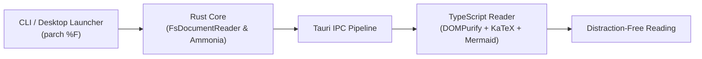

# Welcome to Parch

**Parch** is a native, distraction-free Markdown reader engineered specifically for the Linux desktop with Rust, Tauri v2, and TypeScript.

---

## 1. GitHub-Flavored Markdown (GFM) Tables

| Feature | Support | Performance Target | Specification |
| :--- | :--- | :--- | :--- |
| **Instant Cold Launch** | Native Tauri v2 | $< 300\text{ ms}$ | [spec.md#1.1](file:///home/oyvind/code/personal/parch/specs/001-parchment-markdown-viewer/spec.md) |
| **Live Auto-Reload** | inotify / Debounced | $< 200\text{ ms}$ | [spec.md#6.1](file:///home/oyvind/code/personal/parch/specs/001-parchment-markdown-viewer/spec.md) |
| **In-Document Search** | TextMatchCalculator | $< 50\text{ ms}$ | [spec.md#4.2](file:///home/oyvind/code/personal/parch/specs/001-parchment-markdown-viewer/spec.md) |
| **XSS Defense-in-Depth** | ammonia + DOMPurify | Zero injection | [ADR-0002](file:///home/oyvind/code/personal/parch/doc/adr/0002-markdown-rendering-and-xss-sanitization-pipeline.md) |

---

## 2. Interactive Task Lists

- [x] Implement Rust CLI Argument Parser and exit codes (`0`, `1`, `2`, `3`)
- [x] Dual-layer XSS sanitization via `ammonia` and `DOMPurify`
- [x] Accessible WCAG 2.1/2.2 AA color contrast across Light, Dark, and Sepia themes
- [x] Collapsible Table of Contents with scroll-spy navigation (`Ctrl+\`)
- [x] Real-time client-side Mermaid diagrams and KaTeX mathematical notation
- [ ] Deploy native Debian package and Flatpak bundle

---

## 3. GitHub Alert Callouts

> [!NOTE]
> Parch automatically watches active documents using inotify. Whenever your editor or git branch changes the file on disk, your view reloads instantly while preserving your exact reading scroll ratio.

> [!TIP]
> Press <kbd>F10</kbd> anytime to cycle through **System**, **Light**, **Dark**, and **Sepia** color palettes.

> [!IMPORTANT]
> External network requests are disabled via strict Content Security Policy (`connect-src 'none'`), guaranteeing zero data exfiltration.

> [!WARNING]
> Opening binary files or files larger than 10 MiB is prohibited by the safety pipeline to prevent memory exhaustion.

> [!CAUTION]
> If an active document is deleted on disk, Parch displays a non-destructive warning banner while preserving your current buffer.

---

## 4. Syntax-Highlighted Code Blocks with Copy Button

```rust
use std::path::Path;
use parch_core::document::fs_document_reader::FsDocumentReader;

fn main() -> Result<(), Box<dyn std::error::Error>> {
    let reader = FsDocumentReader::new();
    let doc = reader.read_document(Path::new("examples/welcome.md"))?;
    println!("Loaded document: {} ({} bytes)", doc.location.display_name, doc.byte_size);
    Ok(())
}
```

```typescript
import { ThemeResolver } from './theme/theme-resolver.ts';

const resolver = new ThemeResolver();
const activeTheme = resolver.resolveTheme('sepia', false);
console.info(`Active resolved theme: ${activeTheme}`);
```

---

## 5. Client-Side Mermaid Diagrams



---

## 6. Mathematical Notation (KaTeX)

Parch natively renders inline mathematical expressions like the mass-energy equivalence $E = mc^2$ and Euler's identity $e^{i\pi} + 1 = 0$.

It also centers display block equations with full typography:

$$\frac{-b \pm \sqrt{b^2 - 4ac}}{2a}$$

$$\int_{-\infty}^{\infty} e^{-x^2} \, dx = \sqrt{\pi}$$
