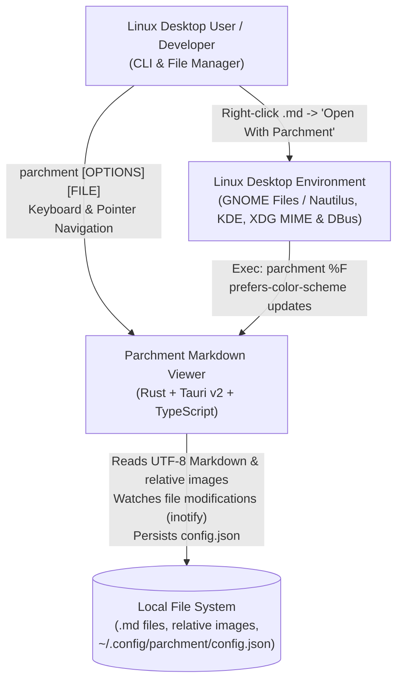
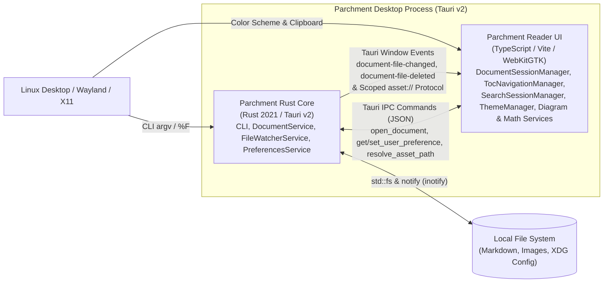
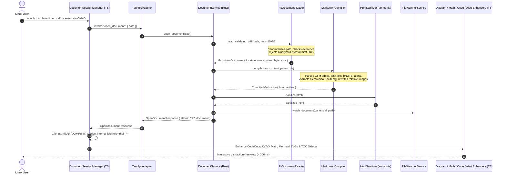
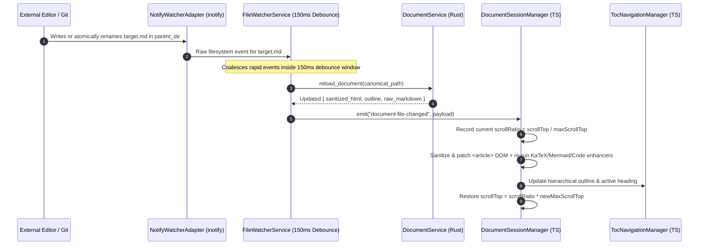

# Technical Implementation Plan: Parchment Markdown Viewer

- **Status**: ACCEPTED
- **Feature**: `001-parchment-markdown-viewer`
- **Architect**: System Architect (`architect`)
- **Date**: 2026-10-28
- **Specification**: [spec.md](file:///home/oyvind/code/personal/parchment/specs/001-parchment-markdown-viewer/spec.md)
- **C4-PlantUML Diagrams**:
  - [doc/context.puml](file:///home/oyvind/code/personal/parchment/doc/context.puml)
  - [doc/container.puml](file:///home/oyvind/code/personal/parchment/doc/container.puml)
  - [doc/component.puml](file:///home/oyvind/code/personal/parchment/doc/component.puml)
- **Architecture Decision Records (ADRs)**:
  - [ADR-0001: Tauri v2, Rust, and TypeScript Domain-Packaged Architecture](file:///home/oyvind/code/personal/parchment/doc/adr/0001-tauri-rust-typescript-architecture.md) (`ACCEPTED`)
  - [ADR-0002: Hybrid Markdown Rendering, Alert Callouts, and Dual-Layer XSS Sanitization Pipeline](file:///home/oyvind/code/personal/parchment/doc/adr/0002-markdown-rendering-and-xss-sanitization-pipeline.md) (`ACCEPTED`)
  - [ADR-0003: Linux XDG Desktop Integration, Theme Sync, and Debounced File Watcher](file:///home/oyvind/code/personal/parchment/doc/adr/0003-linux-xdg-desktop-and-file-watcher-integration.md) (`ACCEPTED`)

---

## 1. Architectural Overview & Guiding Principles

**Parchment** is a native Linux desktop Markdown viewer built with **Rust + Tauri v2** on the backend and **TypeScript + Vite** on the frontend. It adheres strictly to clean architectural principles:

1. **KISS (Keep It Simple, Stupid)**: No unnecessary external frameworks, state management bloat, or multi-layer enterprise indirection. Pure TypeScript domain services manage DOM enhancements, TOC navigation, in-document search, and themes with zero-overhead dependency injection.
2. **Package by Domain (No Technical Layer Buckets)**: Both the Rust backend (`src-tauri/src/<domain>/`) and the TypeScript frontend (`src/<domain>/`) are organized strictly by domain (`document/`, `toc/`, `search/`, `theme/`, `diagram/`, `watcher/`, `preferences/`, `cli/`) rather than technical layers (`controllers/`, `services/`, `models/`).
3. **Technology over Vendor & Dependency Injection**: Every external library or OS dependency (`notify` file watcher, `std::fs`, `@tauri-apps/api`, `DOMPurify`, `mermaid`, `katex`) is encapsulated behind a minimal `*Adapter` interface/trait so core `*Service`, `*Manager`, and `*Builder` classes are 100% unit- and mutation-testable in isolation.
4. **Defense-in-Depth Security**: All Markdown HTML is compiled in Rust (`pulldown-cmark`), sanitized on the backend (`ammonia`) before crossing IPC, and sanitized a second time on the frontend (`DOMPurify`) under a strict Tauri Content Security Policy (`connect-src 'none'`). Relative image paths are canonicalized and sandboxed to the document's parent directory.

---

## 2. C4 Architecture Diagrams (Inline Mermaid)

### 2.1 Level 1: System Context Diagram
*(Canonical PlantUML source: [doc/context.puml](file:///home/oyvind/code/personal/parchment/doc/context.puml))*



### 2.2 Level 2: Container Diagram
*(Canonical PlantUML source: [doc/container.puml](file:///home/oyvind/code/personal/parchment/doc/container.puml))*



### 2.3 Level 3: Component Diagram
*(Canonical PlantUML source: [doc/component.puml](file:///home/oyvind/code/personal/parchment/doc/component.puml))*

```mermaid
flowchart TD
    subgraph RustBackend["Rust Core (src-tauri/src/)"]
        CliParser["cli::CliArgumentParser"]
        DocService["document::DocumentService"]
        DocReader["document::FsDocumentReader"]
        MdCompiler["document::MarkdownCompiler"]
        HtmlSanitizer["document::HtmlSanitizer"]
        AssetResolver["document::AssetPathResolver"]
        WatcherService["watcher::FileWatcherService"]
        NotifyAdapter["watcher::NotifyWatcherAdapter"]
        PrefService["preferences::PreferencesService"]
        XdgStore["preferences::XdgConfigStoreAdapter"]

        CliParser --> DocService
        DocService --> DocReader
        DocService --> MdCompiler
        DocService --> HtmlSanitizer
        DocService --> AssetResolver
        WatcherService --> NotifyAdapter
        WatcherService --> DocService
        PrefService --> XdgStore
    end

    subgraph TsFrontend["TypeScript Reader UI (src/)"]
        IpcAdapter["document::TauriIpcAdapter"]
        SessionMgr["document::DocumentSessionManager"]
        AlertBuilder["document::AlertCalloutBuilder"]
        CodeMgr["document::CodeBlockManager"]
        ClientSanitizer["document::HtmlSanitizerAdapter"]
        TocMgr["toc::TocNavigationManager"]
        SearchMgr["search::SearchSessionManager"]
        ThemeMgr["theme::ThemeManager"]
        DiagramSvc["diagram::DiagramRenderService"]
        MathSvc["diagram::MathRenderService"]

        SessionMgr --> IpcAdapter
        SessionMgr --> ClientSanitizer
        SessionMgr --> AlertBuilder
        SessionMgr --> CodeMgr
        SessionMgr --> TocMgr
        SessionMgr --> DiagramSvc
        SessionMgr --> MathSvc
        ThemeMgr --> IpcAdapter
        ThemeMgr --> DiagramSvc
    end

    IpcAdapter <-->|"Tauri IPC Commands & Events"| DocService
    IpcAdapter <-->|"Tauri IPC Commands"| PrefService
    WatcherService -->|"document-file-changed / deleted"| IpcAdapter
```



---

## 3. Key Runtime Sequences

### 3.1 Document Open & Rendering Pipeline (`open_document`)



### 3.2 Live File Auto-Reload with Scroll Preservation (`document-file-changed`)



---

## 4. Package-by-Domain Directory Layout

Both backend and frontend strictly follow **Package by Domain** and standard component suffixes (`..Service`, `..Manager`, `..Adapter`, `..Reader`, `..Builder`, `..Resolver`, `..Compiler`, `..Sanitizer`). No technical layer folders (`controllers/`, `models/`, `utils/`, `helpers/`) are permitted.

```text
parchment/
├── Cargo.toml / package.json / vite.config.ts / tsconfig.json / eslint.config.js / stryker.config.json
├── index.html
├── packaging/
│   ├── parchment.desktop                        # XDG Desktop Entry ("Open With Parchment", Exec=parchment %F)
│   ├── parchment-mime.xml                       # XDG shared-mime-info registration for text/markdown & .md/.markdown
│   └── icons/
│       └── parchment.svg                        # Scalable application icon for hicolor theme
├── scripts/
│   ├── install-desktop.sh                       # Installs binary, .desktop, MIME XML & runs update-desktop/mime-database
│   ├── uninstall-desktop.sh                     # Cleanly removes installed desktop & MIME integration artifacts
│   └── check-crap.mjs                           # Computes per-function CRAP score from Vitest c8 coverage + ESLint CC
├── doc/
│   ├── context.puml                             # C4 Level 1 System Context (PlantUML)
│   ├── container.puml                           # C4 Level 2 Container Diagram (PlantUML)
│   ├── component.puml                           # C4 Level 3 Component Diagram (PlantUML)
│   └── adr/
│       ├── 0001-tauri-rust-typescript-architecture.md
│       ├── 0002-markdown-rendering-and-xss-sanitization-pipeline.md
│       └── 0003-linux-xdg-desktop-and-file-watcher-integration.md
├── specs/
│   └── 001-parchment-markdown-viewer/
│       ├── spec.md
│       └── plan.md
├── src-tauri/
│   ├── Cargo.toml
│   ├── tauri.conf.json                          # Strict CSP (`connect-src 'none'`), asset protocol scope, window config
│   └── src/
│       ├── main.rs                              # Binary entrypoint: CLI exit code handling (0, 1, 2, 3) & Tauri launch
│       ├── lib.rs                               # Exports domain modules & registers Tauri IPC command handlers
│       ├── cli/                                 # Domain: CLI Argument Parsing & Exit Code Resolution
│       │   ├── mod.rs
│       │   └── cli_argument_parser.rs           # CliArgumentParser (parses [FILE], --theme, --help, --version)
│       ├── document/                            # Domain: Document Loading, GFM Compilation, Sanitization & Asset Security
│       │   ├── mod.rs
│       │   ├── document_models.rs               # DocumentLocation, MarkdownDocument, RenderedContent, TocItem, DocumentError
│       │   ├── fs_document_reader.rs            # FsDocumentReader (10 MiB limit, 8 KiB binary/null-byte detector, UTF-8 check)
│       │   ├── markdown_compiler.rs             # MarkdownCompiler (pulldown-cmark GFM, alerts, heading slug disambiguation)
│       │   ├── html_sanitizer.rs                # HtmlSanitizer (ammonia allowlist, strips <script>, onerror, javascript:)
│       │   ├── asset_path_resolver.rs           # AssetPathResolver (canonicalizes & sandboxes relative images to parent_dir)
│       │   └── document_service.rs              # DocumentService (orchestrates reader, compiler, sanitizer, asset resolver)
│       ├── watcher/                             # Domain: Live File Monitoring & Debouncing
│       │   ├── mod.rs
│       │   ├── watcher_models.rs                # WatcherEvent, WatcherSession, DebouncePolicy (150ms)
│       │   ├── notify_watcher_adapter.rs        # NotifyWatcherAdapter (wraps notify crate on parent directory)
│       │   └── file_watcher_service.rs          # FileWatcherService (filters target filename, debounces changes, handles deletes)
│       └── preferences/                         # Domain: User Preferences & XDG Persistence
│           ├── mod.rs
│           ├── preferences_models.rs            # UserPreferences, ThemeMode (System, Light, Dark, Sepia)
│           ├── xdg_config_store_adapter.rs      # XdgConfigStoreAdapter ($XDG_CONFIG_HOME/parchment/config.json)
│           └── preferences_service.rs           # PreferencesService (validates & updates preferences)
└── src/
    ├── main.ts                                  # Frontend bootstrapper: wires adapters into domain managers
    ├── styles/
    │   └── parchment.css                        # Literary typography, Light/Dark/Sepia CSS variables (WCAG AA >= 4.5:1)
    ├── document/                                # Domain: Frontend Document Session, Alerts, Code Blocks & Sanitization
    │   ├── document-models.ts                   # DocumentPayload, IpcErrorPayload, ScrollCoordinates
    │   ├── tauri-ipc-adapter.ts                 # TauriIpcAdapter (wraps @tauri-apps/api invoke & listen)
    │   ├── html-sanitizer-adapter.ts            # HtmlSanitizerAdapter (wraps DOMPurify defense-in-depth)
    │   ├── alert-callout-builder.ts             # AlertCalloutBuilder (renders [!NOTE], [!TIP], [!IMPORTANT], [!WARNING], [!CAUTION])
    │   ├── code-block-manager.ts                # CodeBlockManager (syntax highlighting + Copy button with "Copied!" feedback)
    │   └── document-session-manager.ts          # DocumentSessionManager (loads document, preserves scroll ratio, handles banners)
    ├── toc/                                     # Domain: Hierarchical Table of Contents & Scroll-Spy
    │   ├── toc-models.ts                        # TocItem, ActiveHeadingState
    │   ├── scroll-spy-calculator.ts             # ScrollSpyCalculator (pure function determining active heading from offsets)
    │   └── toc-navigation-manager.ts            # TocNavigationManager (collapsible sidebar, Ctrl+\ toggle, smooth scroll)
    ├── search/                                  # Domain: In-Document Text Search (Ctrl+F)
    │   ├── search-models.ts                     # SearchState, SearchMatch
    │   ├── text-match-calculator.ts             # TextMatchCalculator (pure case-insensitive substring matcher & index cycler)
    │   └── search-session-manager.ts            # SearchSessionManager (Ctrl+F UI, <mark> highlighting, Enter/Shift+Enter/Esc)
    ├── theme/                                   # Domain: Theme Management & System Color-Scheme Sync
    │   ├── theme-models.ts                      # ThemeMode, ResolvedTheme, ThemePalette
    │   ├── theme-resolver.ts                    # ThemeResolver (pure mapping of ThemeMode + system_is_dark -> ResolvedTheme)
    │   └── theme-manager.ts                     # ThemeManager (applies data-theme, listens to matchMedia & F10 shortcut)
    └── diagram/                                 # Domain: Mermaid Diagrams & KaTeX Mathematical Notation
        ├── diagram-models.ts                    # MermaidRenderResult, MathRenderResult
        ├── mermaid-adapter.ts                   # MermaidAdapter (wraps mermaid.render with theme palette config)
        ├── diagram-render-service.ts            # DiagramRenderService (isolated error boundary + expandable raw snippet)
        ├── katex-adapter.ts                     # KatexAdapter (wraps katex.renderToString for inline $...$ & block $$...$$)
        └── math-render-service.ts               # MathRenderService (renders math expressions with non-crashing red fallback)
```

---

## 5. Domain Component Contracts & Responsibilities

### 5.1 Rust Backend Domains (`src-tauri/src/`)

| Domain | Component | Responsibility & Invariants |
| :--- | :--- | :--- |
| `cli` | `CliArgumentParser` | Pure parser for `parchment [OPTIONS] [FILE]`. Supports `-t/--theme <system\|light\|dark\|sepia>`, `-h/--help`, `-V/--version`. Maps invalid flags to exit code `1`, missing files on CLI startup to exit code `2` (or interactive error screen when launched from GUI), and binary files to exit code `3`. |
| `document` | `FsDocumentReader` | Validates path existence and regular-file status (`canonicalize()`), enforces `MAX_DOCUMENT_SIZE = 10 MiB` (`FILE_TOO_LARGE`), inspects the first `8 KiB` for null bytes (`0x00`) or binary magic headers (`BINARY_FILE_DETECTED`), and decodes valid UTF-8. |
| `document` | `MarkdownCompiler` | Parses GFM via `pulldown-cmark` (`ENABLE_TABLES`, `ENABLE_TASKLISTS`, `ENABLE_STRIKETHROUGH`, `ENABLE_HEADING_ATTRIBUTES`). Extracts hierarchical `Vec<TocItem>` with deterministic duplicate-safe slugs (`id`, `id-1`, `id-2`). Detects GitHub alert syntax (`> [!NOTE]`, `[!TIP]`, `[!IMPORTANT]`, `[!WARNING]`, `[!CAUTION]`) and emits semantic `<aside class="markdown-alert markdown-alert-note" data-alert-type="note">` blocks. Preserves `mermaid` code fences and `$...$` / `$$...$$` math delimiters for client-side rendering. |
| `document` | `HtmlSanitizer` | Configures `ammonia::Builder` to strip `<script>`, `<iframe>`, `<object>`, `<embed>`, `<style>`, `<form>`, all `on*` event attributes (`onerror`, `onload`, `onclick`), and disallow `javascript:`, `vbscript:`, and `data:text/html` URI schemes while permitting safe GFM elements, `input[type="checkbox"][disabled]`, and `data-alert-type` / `data-line` / `id` / `class` attributes. |
| `document` | `AssetPathResolver` | Resolves relative image URLs against `document.location.parent_dir`. Canonicalizes the target path and verifies `resolved_path.starts_with(&parent_dir)`. Rejects `../../../../etc/shadow` with `DIRECTORY_TRAVERSAL_PROHIBITED`. Rewrites valid local image paths to Tauri's scoped `asset://` URI. |
| `document` | `DocumentService` | Coordinates `FsDocumentReader`, `MarkdownCompiler`, `AssetPathResolver`, and `HtmlSanitizer` to implement the `open_document` and `resolve_asset_path` IPC contracts. |
| `watcher` | `FileWatcherService` & `NotifyWatcherAdapter` | Monitors the active document's parent directory via `notify` (`inotify` on Linux). Filters events matching the target filename, coalesces rapid writes within a `150ms` debounce window (`Scenario 6.1`), and emits `document-file-changed` or `document-file-deleted` (`Scenario 6.2`). Automatically resumes live reloads if a deleted file is recreated at the same path. |
| `preferences` | `PreferencesService` & `XdgConfigStoreAdapter` | Reads and writes `$XDG_CONFIG_HOME/parchment/config.json` (fallback `~/.config/parchment/config.json`). Enforces schema defaults (`version: 1`, `theme_mode: "system"`, `toc_visible: true`, `font_size_px: 16`, `line_width_ch: 75`, `auto_reload: true`). |

### 5.2 TypeScript Frontend Domains (`src/`)

| Domain | Component | Responsibility & Invariants |
| :--- | :--- | :--- |
| `document` | `DocumentSessionManager` | Orchestrates opening documents, Empty State view (`Ctrl+O`), Error views (`FILE_NOT_FOUND`, `BINARY_FILE_DETECTED`), and live-reload DOM updates while preserving exact vertical scroll ratio (`scrollTop / scrollHeight`) or active heading anchor. Displays non-destructive warning banner on `document-file-deleted`. |
| `document` | `AlertCalloutBuilder` | Enhances GFM alert blockquotes (`[!NOTE]`, `[!TIP]`, `[!IMPORTANT]`, `[!WARNING]`, `[!CAUTION]`) with accessible SVG icons, badge titles, and ARIA attributes (`role="note"` / `role="region"`). |
| `document` | `CodeBlockManager` | Applies theme-aware syntax highlighting (`highlight.js` core subset) and attaches a keyboard-accessible "Copy" button (`aria-label="Copy code"`) that writes raw code to `navigator.clipboard` and transitions to `"Copied! ✓"` for 2,000ms (`Scenario 2.3`). |
| `toc` | `TocNavigationManager` & `ScrollSpyCalculator` | Renders collapsible hierarchical TOC (`<nav aria-label="Table of Contents">`), handles `Ctrl+\` toggle (`aria-expanded`), smooth-scrolls to heading anchors on click, and highlights the currently visible section during scrolling via `ScrollSpyCalculator`. |
| `search` | `SearchSessionManager` & `TextMatchCalculator` | Implements `Ctrl+F` floating search bar with `aria-live="polite"` match counter (`1 of 14` or `0 matches`), `<mark class="parchment-search-match">` DOM highlighting, `Enter` (Next), `Shift+Enter` (Prev), and `Esc` (close & strip marks). |
| `theme` | `ThemeManager` & `ThemeResolver` | Resolves `System`, `Light`, `Dark`, and `Sepia` modes against OS `window.matchMedia('(prefers-color-scheme: dark)')` and Tauri `system-theme-changed` events. Persists manual toggles (`F10` or Theme Selector) via `set_user_preference`. Guarantees $\ge 4.5:1$ WCAG AA contrast across all 4 themes. |
| `diagram` | `DiagramRenderService` & `MathRenderService` | Renders `mermaid` blocks into inline responsive SVGs matching the active theme palette; catches syntax errors per block and renders `[Mermaid Diagram Error: Unable to render syntax]` with an expandable `<details>` raw snippet disclosure (`Scenario 5.2`). Renders inline (`$...$`) and block (`$$...$$`) math via `KaTeX` (`throwOnError: false`, `errorColor: '#cc0000'`, `Scenario 5.3`). |

---

## 6. Linux Desktop Integration Artifacts ("Open With Parchment")

To ensure users on Ubuntu/GNOME, KDE, XFCE, and other XDG-compliant Linux distributions/VMs can right-click any `.md` or `.markdown` file in their file manager and select **"Open With Parchment"**, the repository includes four dedicated packaging artifacts:

1. **`packaging/parchment.desktop`**:
   - Follows the Freedesktop Desktop Entry Specification (`Exec=parchment %F`, `MimeType=text/markdown;text/x-markdown;text/plain;`, `StartupNotify=true`, `StartupWMClass=parchment`).
2. **`packaging/parchment-mime.xml`**:
   - Standard XDG `shared-mime-info` XML definition associating `*.md`, `*.markdown`, and `*.mkd` glob patterns with `text/markdown` and `text/x-markdown` (ensuring minimal VMs or older distros recognize `.md` files as Markdown).
3. **`scripts/install-desktop.sh`**:
   - Supports both user-local installation (`~/.local/bin`, `~/.local/share/applications`, `~/.local/share/mime`, `~/.local/share/icons/hicolor/scalable/apps`) and system-wide installation (`/usr/local/bin`, `/usr/share/applications`, `/usr/share/mime`).
   - Validates `parchment.desktop` with `desktop-file-validate` (if installed), updates the MIME database via `update-mime-database`, updates the application cache via `update-desktop-database`, and registers `parchment.desktop` as an available handler via `xdg-mime`.
4. **`scripts/uninstall-desktop.sh`**:
   - Cleanly removes the installed binary, `.desktop` file, MIME XML, and icon, and refreshes the XDG databases.

---

## 7. Quality Gates: TDD, Mutation Testing ($\ge 80\%$), and Hybrid CRAP ($\le 8$)

To make verification fast, deterministic, and 100% automated in Phase 2 and Phase 3:

1. **Small, Focused Functions ($CC \le 7$, $\text{CRAP} \le 8$)**:
   - ESLint is configured with `"complexity": ["error", { "max": 7 }]` across `src/**/*.ts`.
   - Vitest runs with `@vitest/coverage-v8` (`c8` / Istanbul JSON output), and `scripts/check-crap.mjs` computes the exact $\text{CRAP}(m) = \text{comp}(m)^2 \times \left(1 - \frac{\text{cov}(m)}{100}\right)^3 + \text{comp}(m)$ score for every function, failing if any function exceeds `8.0`.
   - In Rust (`src-tauri/src/`), `#[deny(clippy::cognitive_complexity)]` (`cognitive-complexity-threshold = 7` in `clippy.toml`) and modular helper functions keep every function's cyclomatic complexity $\le 6$ with $> 90\%$ unit test line/branch coverage.
2. **Mutation Testing ($\ge 80\%$ Score)**:
   - **TypeScript Domain (`src/**/*.ts`)**: `@stryker-mutator/core` + `@stryker-mutator/vitest-runner` targets all pure domain logic (`src/document/`, `src/toc/`, `src/search/`, `src/theme/`, `src/diagram/`) with `"thresholds": { "high": 85, "low": 80, "break": 80 }`.
   - **Rust Backend Domain (`src-tauri/src/**/*.rs`)**: `cargo-mutants` tests domain modules (`cli`, `document`, `watcher`, `preferences`) with a minimum required score of `>= 80%`.
   - Decoupling `src-tauri` domain modules in `lib.rs` from the GUI window startup in `main.rs` allows `cargo test` and `cargo-mutants` to execute purely in-memory in seconds without needing an X11/Wayland display server.

---

## 8. Security, CSP, and Operational SLIs

### 8.1 Security & Sandboxing
- **Content Security Policy (`src-tauri/tauri.conf.json`)**:
  ```text
  default-src 'self'; img-src 'self' asset: http://asset.localhost data:; style-src 'self' 'unsafe-inline'; font-src 'self' data:; script-src 'self'; connect-src 'none'; object-src 'none'; base-uri 'none';
  ```
- **Zero Exfiltration**: `connect-src 'none'` guarantees no telemetry or external network requests can occur from untrusted Markdown documents.
- **Asset Protocol Scope**: Restricted strictly to validated local asset paths resolved by `AssetPathResolver`.

### 8.2 Operational SLIs & NFR Targets
- **Cold Launch Latency**: $< 300\text{ ms}$ from CLI invocation to interactive render for $\le 50\text{ KB}$ documents.
- **Live Reload Latency**: $< 200\text{ ms}$ end-to-end (including $150\text{ ms}$ debounce window).
- **Search Query Latency**: $< 50\text{ ms}$ match calculation and highlight update for documents up to $50,000$ words.
- **Memory Budget**: $< 150\text{ MB}$ RSS for documents up to $5\text{ MiB}$.
- **Structured Logging**: Structured JSON/key-value diagnostics emitted to `stdout`/`stderr` only (12-factor compliant; no proprietary log agents).

---

## 9. Human Review & Approval Sign-off

> [!IMPORTANT]
> **Mandatory Human Approval Gate**: This Technical Implementation Plan and its associated C4 diagrams (`doc/*.puml`) and ADRs (`doc/adr/0001..0003`) are currently in `Status: PROPOSED`. Implementation (`tasks.md` and Phase 2 TDD) must wait until the human reviewer approves and transitions status to `ACCEPTED`.

- **Architect Signature**: `architect` (System Architect Subagent)
- **Human Reviewer**: Pending Human Review
- **Decision**: [ ] Approved (`ACCEPTED`)   [ ] Changes Requested
- **Approval Date**: Pending
